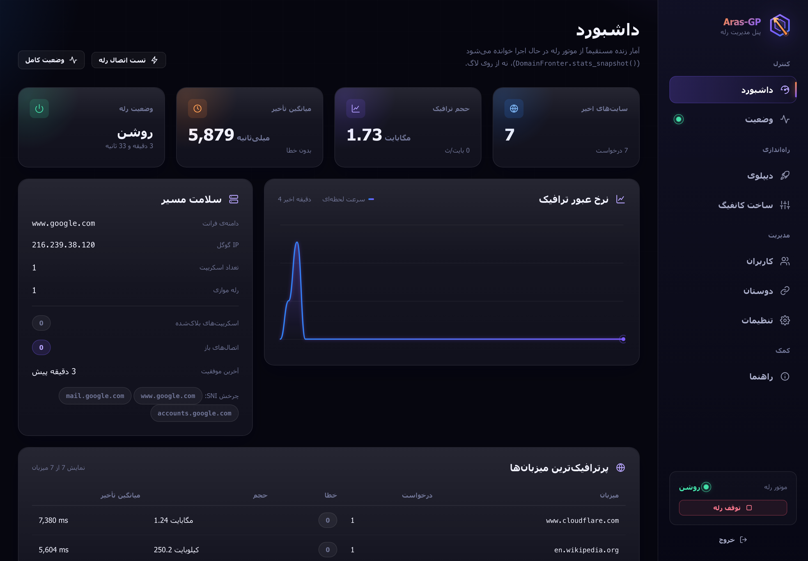

<div align="center">


# Aras-GP

**پنل مدیریت رله‌ی عبور از فیلترینگ، بر پایه‌ی Domain Fronting**

ترافیک شما به‌شکل یک اتصال TLS معمولی به گوگل درمی‌آید.

[](https://www.python.org/)
[](docs/install.md)
[](LICENSE)
[](#امنیت)



</div>

---

## این چیست

مرورگر شما به یک پروکسی محلی وصل می‌شود. آن پروکسی درخواست را از یک اسکریپت
Google Apps Script و سپس یک Cloudflare Worker عبور می‌دهد — **هر دو مال خودتان**.


آنچه ISP می‌بیند یک اتصال TLS به گوگل است، نه مقصد واقعی.

پنل این‌ها را می‌دهد: داشبورد آمار زنده از موتور در حال اجرا، دیپلوی خودکار
Worker و تولید `Code.gs`، فرم کامل کانفیگ، کاربران با سهمیه‌ی حجمی و انقضا،
لینک `vless://` برای دوستان، سوییچ خودکار بین رله‌ها، و پشتیبان‌گیری.

---

## نصب

نیازها: **Python 3.10+**، یک **حساب Google**، و یک **توکن API کلودفلر**
(پنل لینک ساختنش را می‌دهد).

```bash
git clone https://github.com/ArasTey/Aras-GP.git
cd Aras-GP
python3 manage.py
```

گزینه‌ی **۱ (Install)** را بزنید: وابستگی‌ها نصب می‌شوند، دستور سراسری `agp`
ساخته می‌شود، و پیشنهاد اجرای پنل را می‌دهد. از آن به بعد فقط:

```bash
agp
```

روی ویندوز `python manage.py` یا `agp.bat`. با داکر `docker compose up -d`.
جزئیات هر سیستم‌عامل: **[راهنمای نصب](docs/install.md)**

---

## راه‌اندازی

پنل یک صفحه‌ی راهنما با چک‌لیست پیشرفت واقعی دارد؛ همان را دنبال کنید. خلاصه:

| گام | کار | کجا |
|:--|:--|:--|
| ۱ | کلید احراز هویت | خودکار ساخته می‌شود |
| ۲ | دیپلوی Cloudflare Worker | صفحه‌ی **دیپلوی** |
| ۳ | ساخت و انتشار `Code.gs` | همان صفحه → کپی در [script.google.com](https://script.google.com) |
| ۴ | نصب گواهی CA | صفحه‌ی **وضعیت** |
| ۵ | روشن‌کردن رله | داشبورد |
| ۶ | تنظیم مرورگر یا سیستم | `127.0.0.1:8085` (HTTP) یا `:1080` (SOCKS5) |

> **مهم:** هنگام انتشار Apps Script باید **Execute as: Me** و
> **Who has access: Anyone** را انتخاب کنید. اگر این را جا بیندازید، رله روی
> هر درخواست `403` می‌دهد.

**[→ راه‌اندازی گام‌به‌گام با تصویر](docs/setup.md)**

---

## مدیریت روزمره

منوی `agp` همه‌چیز را پوشش می‌دهد: تغییر پورت و رمز، دسترسی شبکه‌ی محلی،
پشتیبان‌گیری و بازگردانی، autostart، بازگشت به تنظیمات کارخانه. برای
اسکریپت‌نویسی، همان کارها بدون منو:

```bash
agp start      # روشن‌کردن پنل
agp stop       # خاموش‌کردن
agp restart    # ری‌استارت
agp status     # running / stopped
agp version    # نسخه
```

**[→ مدیریت و اجرای دائمی](docs/managing.md)** ·
**[کاربران و سهمیه](docs/users.md)** ·
**[پشتیبان‌گیری](docs/backup.md)**

---

## سقف مصرف روزانه

نه Google و نه Cloudflare با حجم محدود می‌کنند — **با تعداد فراخوان**:

| | حساب معمولی | Workspace / Paid |
|:--|:--|:--|
| Apps Script (urlfetch) | ۲۰٬۰۰۰ در روز | ۱۰۰٬۰۰۰ |
| هر POST و هر پاسخ | ۵۰ مگابایت | ۵۰ مگابایت |
| Cloudflare Workers | ۱۰۰٬۰۰۰ در روز | نامحدود |

پس حجم قابل انتقال به **بایت بر فراخوان** بستگی دارد:

| کار | حساب معمولی | Workspace |
|:--|:--|:--|
| دانلود، تکه‌ی ۵۱۲ کیلوبایتی (پیش‌فرض) | ~۱۰ گیگابایت | ~۴۹ گیگابایت |
| دانلود، تکه‌ی ۲ مگابایتی | ~۳۹ گیگابایت | ~۱۹۵ گیگابایت |
| آپلود (سقف ۳۷ مگابایت در هر درخواست) | ~۷۲۷ گیگابایت | ~۳٬۶۳۷ گیگابایت |
| مرور وب معمولی | سهمیه با ~۲۰٬۰۰۰ درخواست ته می‌کشد | — |

بزرگ‌ترین بردِ استفاده‌نشده: `chunked_download_chunk_size` پیش‌فرض ۵۱۲ کیلوبایت
است، در حالی که سقف پاسخ Apps Script ۵۰ مگابایت است. بردنش روی ۲ مگابایت سقف
دانلود روزانه را حدود **چهار برابر** می‌کند.

سهمیه روی پنجره‌ی **متحرک ۲۴ ساعته از اولین فراخوان** پر می‌شود، نه نیمه‌شب.
پنل مصرف فعلی را نشان می‌دهد، پس لازم نیست برای پیدا کردن سقف به آن بخورید.

---

## امنیت

این ابزار برای عبور از سانسور است، پس **عمداً** این‌ها را ندارد:

| ندارد | چرا |
|:--|:--|
| تله‌متری یا phone-home | هیچ IP، آمار یا هویتی به هیچ سرور مرکزی نمی‌رود |
| کیل‌سوییچ از راه دور | هیچ کانالی برای غیرفعال‌کردن رله‌ی شما نیست |
| کد مبهم‌سازی‌شده | ابزاری که کاربرش نتواند حسابرسی‌اش کند، بدتر از نبودنش است |
| CDN خارجی | یک درخواست به CDN، خودِ اجرای این ابزار را لو می‌دهد |
| سرور لایسنس | قفل لایسنس کاملاً آفلاین است |

**کل مقصدهای خروجی این پروسه:** `api.cloudflare.com` (فقط هنگام دیپلوی یا
بررسی توکن)، و Apps Script و Worker **خودِ شما**. همین فهرست در پنل هم نشان
داده می‌شود.

**تدابیر:** PBKDF2-HMAC-SHA256 با ۱۲۰٬۰۰۰ دور · نشست `HttpOnly` +
`SameSite=Lax` با انقضای ۱۲ ساعت · CSRF روی همه‌ی درخواست‌های غیر-GET ·
rate limit روی لاگین و دیپلوی · CSP بدون `unsafe-inline` (هر بلاک inline
یک nonce یکبارمصرف دارد) · `config.json` و `panel/data/*` با مجوز `0600` و
نوشتن اتمیک · توکن کلودفلر پیش‌فرض ذخیره نمی‌شود.

> ⚠️ پنل پیش‌فرض روی `127.0.0.1` گوش می‌دهد. اگر روی شبکه بازش کردید، حتماً
> پشت VPN یا reverse proxy با TLS بگذاریدش — پنل `auth_key` و توکن کلودفلر را
> در اختیار دارد. خودِ پنل هنگام bind روی آدرس غیر-loopback هشدار می‌دهد.

---

## مستندات

| | |
|:--|:--|
| [نصب](docs/install.md) | لینوکس، مک، ویندوز، داکر |
| [راه‌اندازی گام‌به‌گام](docs/setup.md) | از صفر تا رله‌ی کارکننده، با تصویر |
| [مدیریت و اجرای دائمی](docs/managing.md) | منوی `agp`، autostart، systemd |
| [کاربران و سهمیه](docs/users.md) | احراز هویت، سهمیه‌ی حجمی، لینک دوستان |
| [پشتیبان‌گیری](docs/backup.md) | بکاپ، بازگردانی، سوییچ خودکار |
| [مرجع `config.json`](docs/config.md) | همه‌ی کلیدها و مقادیر پیش‌فرض |
| [مرجع API](docs/api.md) | endpointهای پنل |
| [مرجع اسکریپت‌ها](docs/scripts.md) | `Code.gs` و `worker.js` |
| [معماری](docs/architecture.md) | ساختار `engine/` و `panel/` |
| [عیب‌یابی](docs/troubleshooting.md) | خطاهای رایج و درمانشان |
| [نمای پنل](docs/gallery.md) | تصویر همه‌ی صفحه‌ها |

---

## توسعه

```bash
python3 -m py_compile engine/*.py panel/*.py main.py manage.py
python3 -m pyflakes  engine/*.py panel/*.py main.py manage.py
```

> این پروژه هنوز **مجموعه‌ی تست خودکار ندارد**. تغییرات دستی آزمایش شده‌اند، و
> مسیرهای ویندوز و لینوکس (نصب گواهی و autostart) روی همان سیستم‌عامل‌ها
> اجرا نشده‌اند. اگر مشارکت می‌کنید، تست بهترین جای شروع است.

---

## لایسنس

| بخش | پروانه |
|:--|:--|
| `panel/` | اختصاصی — [`panel/LICENSE`](panel/LICENSE) |
| `engine/`, `deploy/`, `main.py`, `setup.py` | MIT — [`LICENSE`](LICENSE) |

پروانه‌ی پنل اجرای خصوصی نامحدود و حسابرسی امنیتی را آزاد می‌گذارد؛ ری‌برندسازی
و فروش مجدد بدون اجازه‌ی کتبی مجاز نیست.

## سلب مسئولیت

این نرم‌افزار فقط برای اهداف آموزشی، تحقیقاتی و تست ارائه شده است. «همان‌طور که
هست» (AS IS)، بدون هیچ ضمانتی. رعایت قوانین محلی و شرایط استفاده‌ی Google و
Cloudflare بر عهده‌ی کاربر است.

---

<div align="center">

## English

**Aras-GP** is a Persian, RTL web panel for running a domain-fronting relay.
Traffic leaves as an ordinary TLS connection to Google, routed through a Google
Apps Script and a Cloudflare Worker that you own.

The panel handles Worker deployment over the Cloudflare REST API, `Code.gs`
generation, CA trust, per-connection authentication (HTTP Basic + SOCKS5
RFC 1929) with per-user traffic quotas and automatic cut-off, `vless://` links,
passive relay failover, and backups.

```bash
git clone https://github.com/ArasTey/Aras-GP.git && cd Aras-GP
python3 manage.py        # option 1 installs, then just run: agp
```

Daily ceilings are metered in **calls, not gigabytes**: 20,000 Apps Script
urlfetch calls a day on a consumer account (100,000 on Workspace), 50 MB per
POST and per response, and 100,000 Cloudflare Workers requests a day on the
free plan. Raising `chunked_download_chunk_size` from 512 KB to 2 MB roughly
quadruples the daily download ceiling. Quota refills on a rolling 24-hour
window from the first call, not at midnight.

No telemetry, no phone-home, no remote kill switch, no external CDN, no license
server. The only outbound call the panel makes is `api.cloudflare.com` during a
deploy. A censorship-circumvention tool must not become the surveillance
chokepoint it exists to avoid.

**[Install](docs/install.md)** · **[Setup](docs/setup.md)** ·
**[Config](docs/config.md)** · **[API](docs/api.md)** ·
**[Architecture](docs/architecture.md)** ·
**[Troubleshooting](docs/troubleshooting.md)**

</div>
