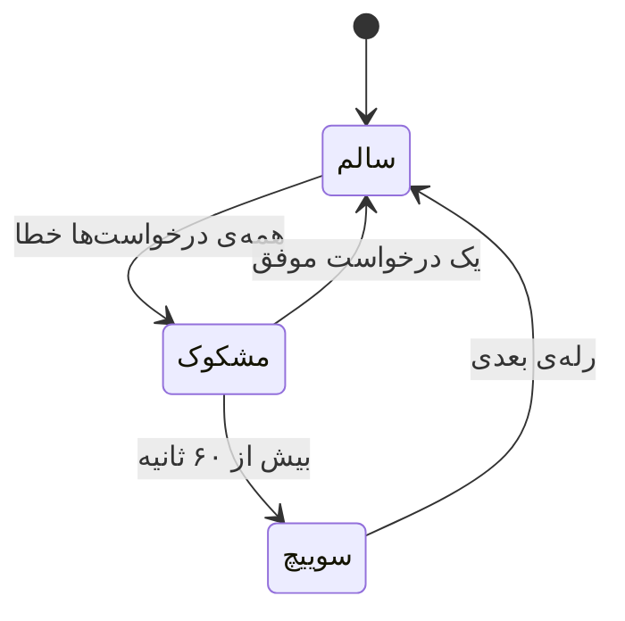

# پشتیبان‌گیری و سوییچ خودکار

[← بازگشت به README](../README.md)


هر زنجیره‌ی کارکرده را می‌توانید در صفحه‌ی دیپلوی با یک نام **ذخیره** کنید.
دفعه‌ی بعد به‌جای دیپلوی دوباره، یک کلیک سوییچ می‌کنید.

با روشن‌کردن **«سوییچ خودکار»** در تنظیمات، اگر رله‌ی فعال بیش از آستانه
(پیش‌فرض ۶۰ ثانیه) پیوسته خطا بدهد، پنل خودش به رله‌ی بعدی می‌رود.



**تشخیص کاملاً منفعل است.** از روی شمارنده‌های ترافیک واقعی خوانده می‌شود، نه
پینگ دوره‌ای — چون یک ابزار عبور از سانسور که هر چند ثانیه heartbeat می‌فرستد،
هم سهمیه‌ی Apps Script را هدر می‌دهد و هم یک الگوی قابل‌شناسایی روی شبکه می‌سازد.

محافظت در برابر نوسان:

- رله‌ی **بی‌کار** هرگز «خراب» حساب نمی‌شود — بدون ترافیک، بدون قضاوت
- اگر **اخیراً موفقیتی** بوده، سوییچ نمی‌کند (یعنی یک سایت خراب کل تونل را جابه‌جا نمی‌کند)
- حداقل فاصله بین دو سوییچ: ۹۰ ثانیه
- با کمتر از دو رله‌ی ذخیره‌شده، اصلاً کاری نمی‌کند

---

<a id="backup"></a>

## 💾 پشتیبان‌گیری

در صفحه‌ی **تنظیمات**:

| دکمه | شامل |
|:--|:--|
| 📥 **پشتیبان کامل** | کانفیگ، کاربران، رله‌ها، پروفایل‌ها، تنظیمات |
| 👁️ **بدون رمزها** | همان فایل بدون `auth_key` و بدون هش رمز کاربران |
| 🔄 **بازگردانی** | از فایل پشتیبان |
| 🗑️ **پاک‌کردن همه** | با تأیید تایپی `DELETE` — رمز پنل حفظ می‌شود |

> 🔒 توکن Cloudflare **هرگز** داخل فایل پشتیبان نوشته نمی‌شود، حتی در نسخه‌ی کامل.

```bash
# پشتیبان‌گیری از خط فرمان
curl -b cookies.txt http://127.0.0.1:8600/api/backup/export -o backup.json
curl -b cookies.txt "http://127.0.0.1:8600/api/backup/export?secrets=0" -o backup-safe.json
```

---

<a id="config-ref"></a>
