# نمای پنل

[← بازگشت به README](../README.md)

<b>📊 داشبورد</b> — آمار زنده، نمودار سرعت، سلامت مسیر

 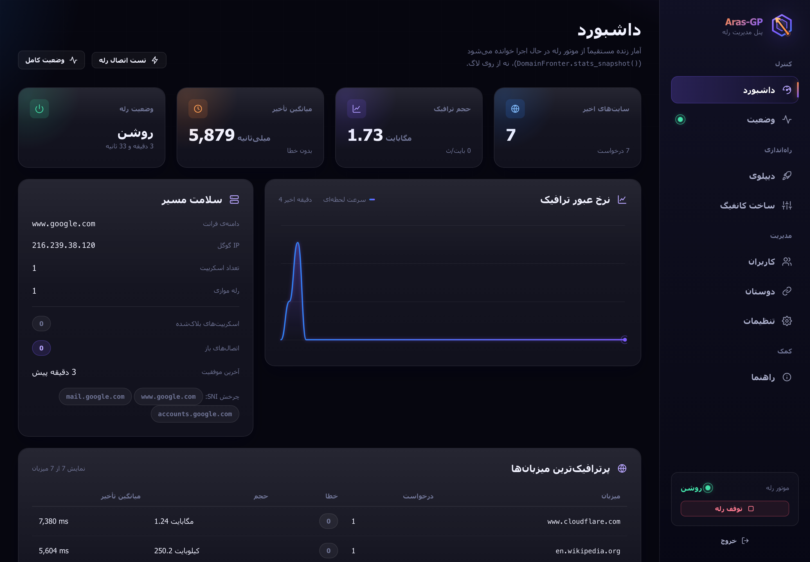

<b>🔗 دوستان</b> — لینک VLESS برای موبایل، لینک اشتراک

 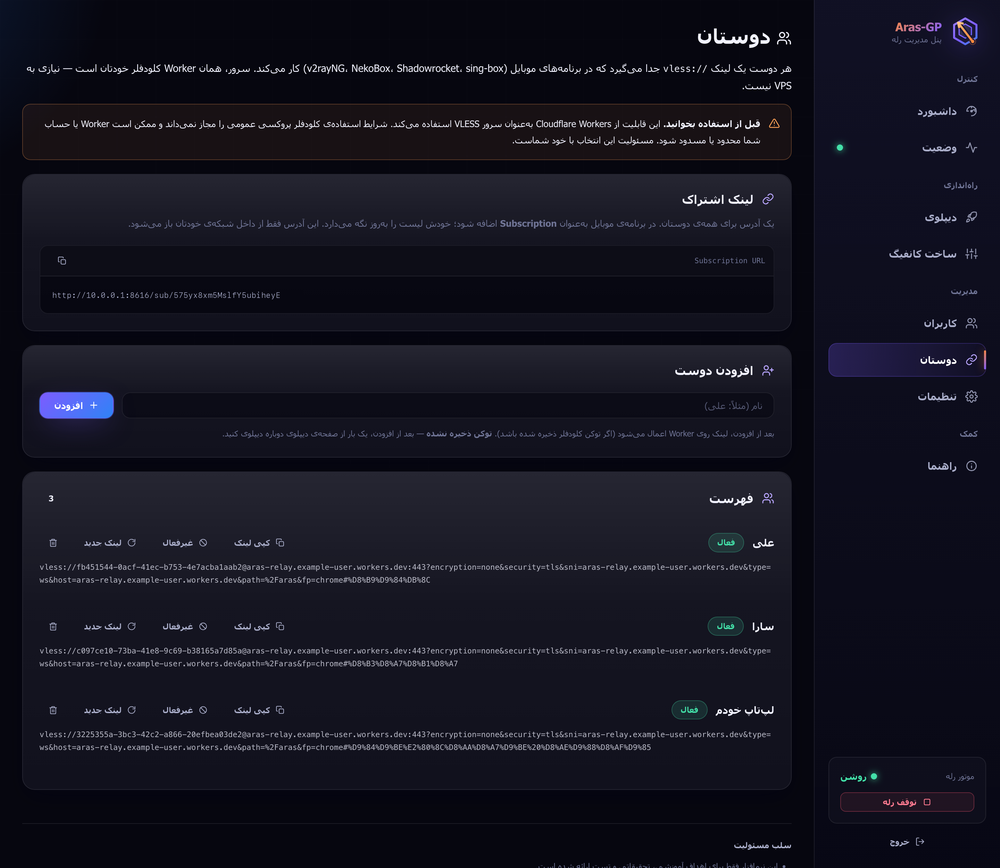

<b>👥 کاربران</b> — سهمیه، انقضا، وضعیت لحظه‌ای، قطع اتصال

 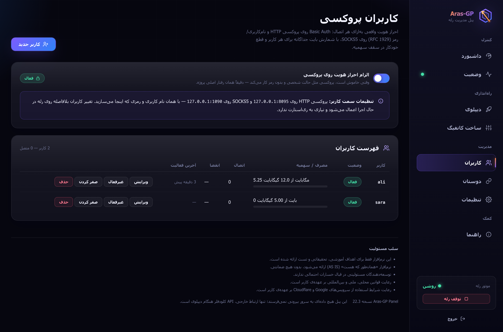

<b>🚀 دیپلوی</b> — Worker خودکار، Code.gs، ذخیره‌ی رله

 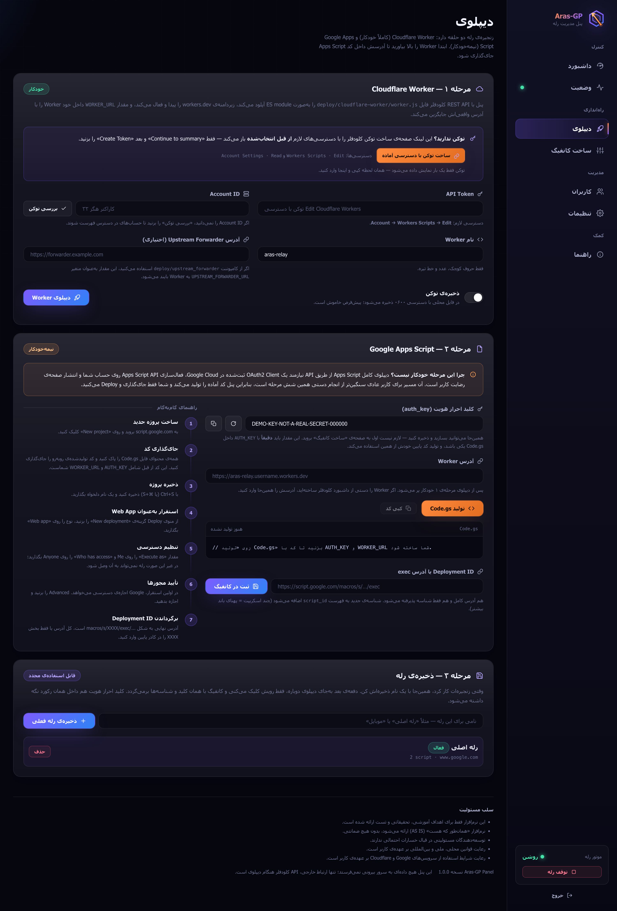

<b>🩺 وضعیت</b> — سلامت زنجیره، گواهی CA، لاگ زنده

 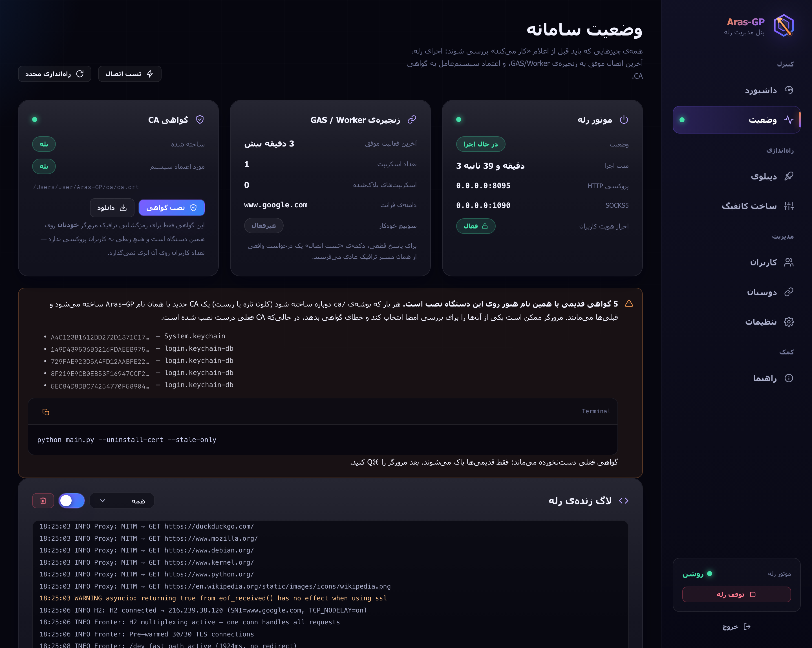

<b>🎛️ ساخت کانفیگ</b> — همه‌ی کلیدها در یک فرم

 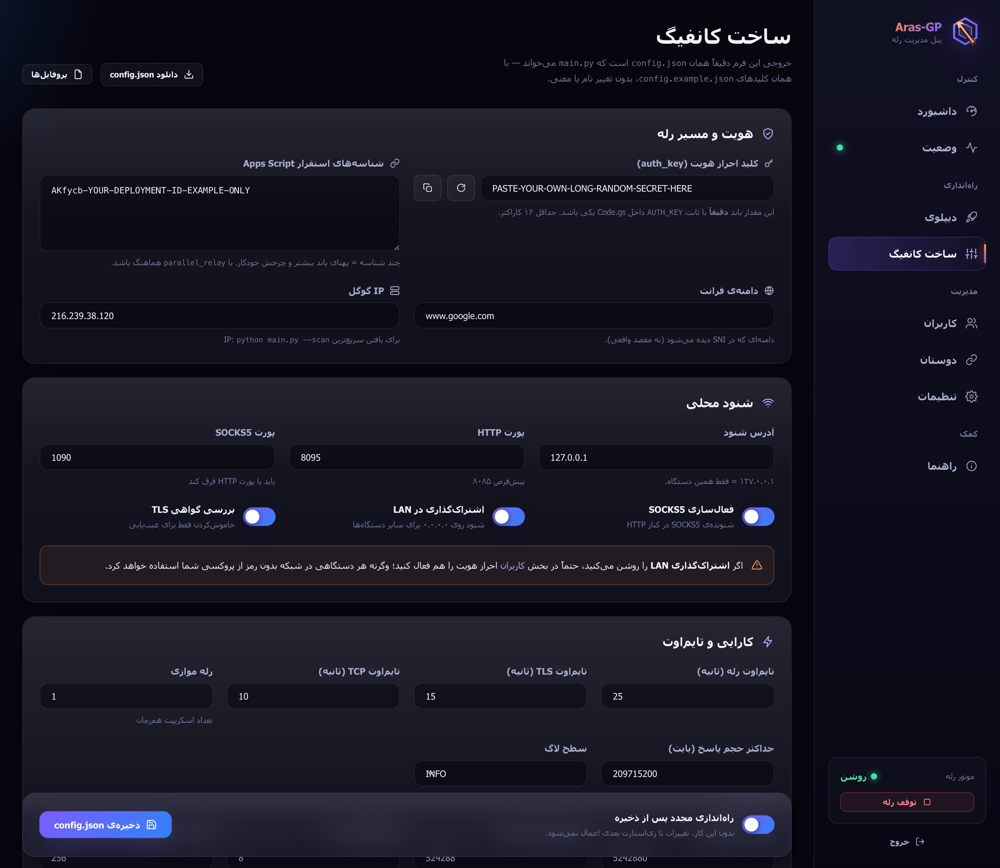

<b>⚙️ تنظیمات</b> — پشتیبان‌گیری، سوییچ خودکار

 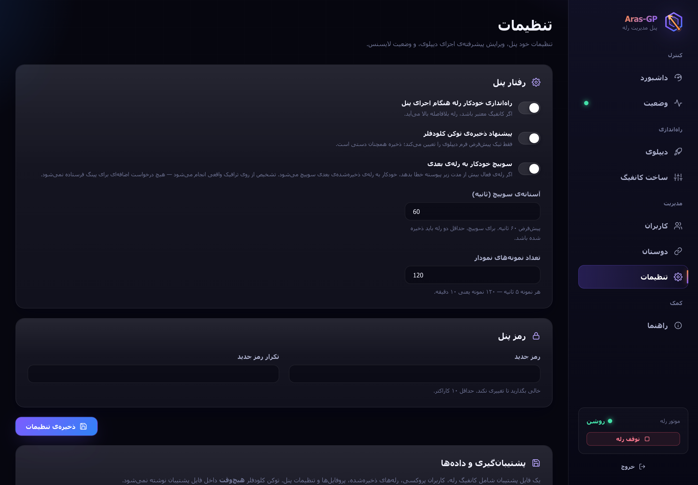

<b>📖 راهنما</b> — آموزش داخل پنل با چک‌لیست پیشرفت

 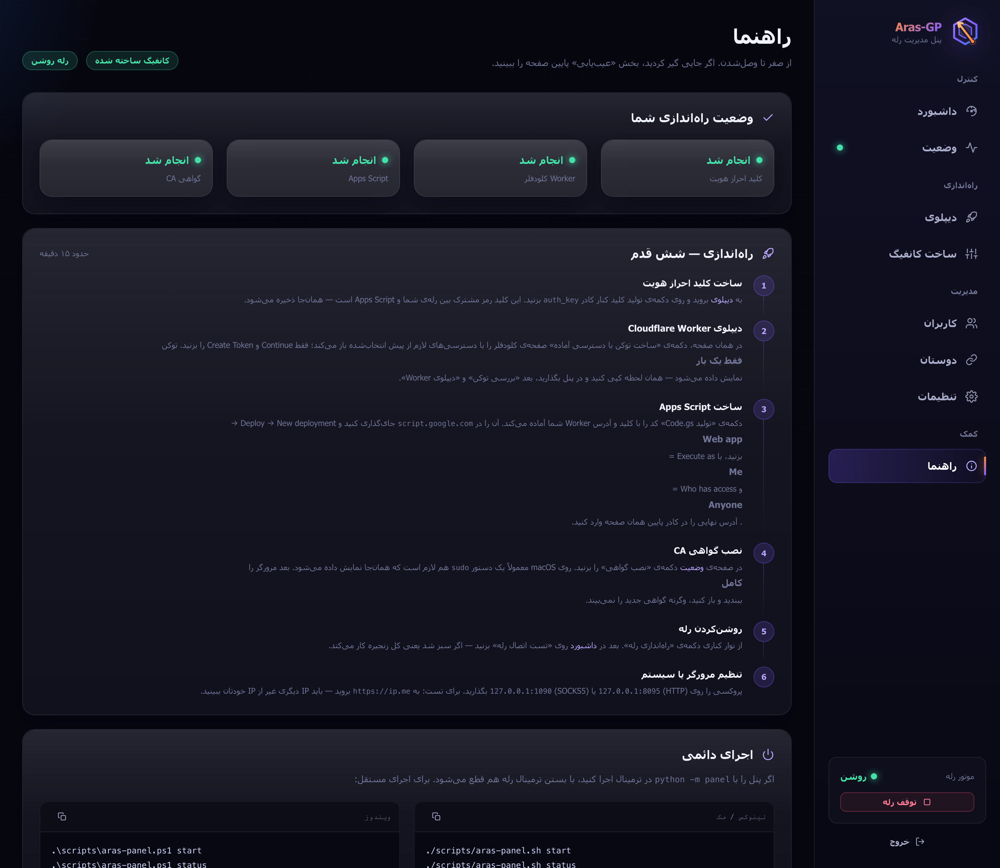

<b>📱 روی موبایل</b> — کل پنل روی گوشی کار می‌کند

 

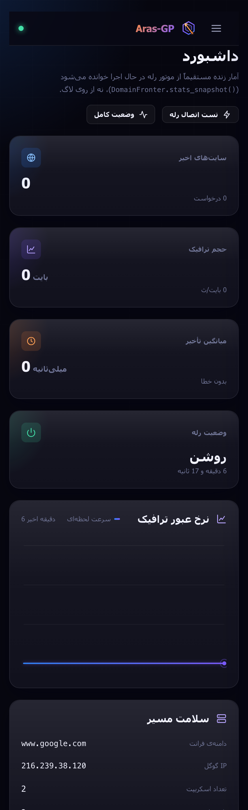
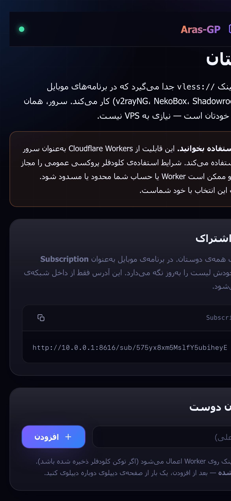
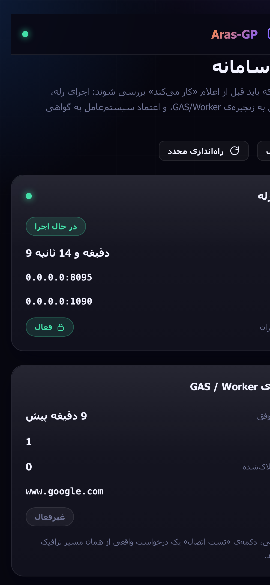

<b>🔐 ورود</b>

 
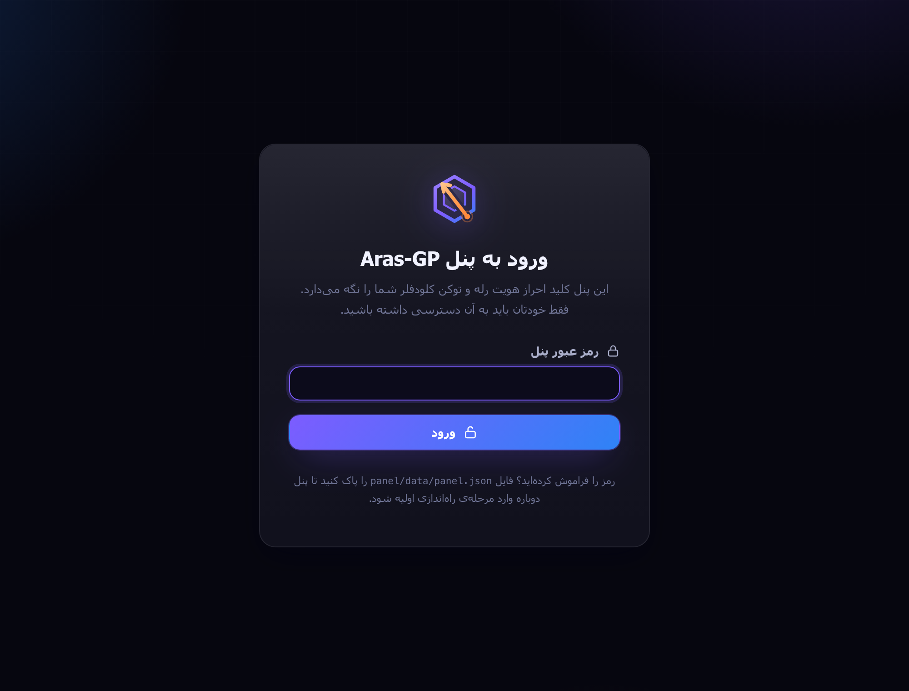

