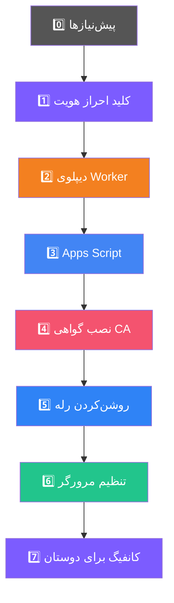

# راه‌اندازی گام‌به‌گام

[← بازگشت به README](../README.md)


> صفحه‌ی **راهنما** داخل پنل همین مراحل را با چک‌لیست پیشرفت واقعی شما نشان می‌دهد.



### ۰️⃣ قبل از شروع — چه چیزهایی لازم دارید

| مورد | چرا | اگر نداشته باشید |
|:--|:--|:--|
| **Python 3.10 یا بالاتر** | کل پروژه با پایتون است | از [python.org](https://www.python.org/downloads/) نصب کنید. روی ویندوز حتماً تیک **Add python.exe to PATH** |
| **یک حساب Google** | Apps Script روی آن اجرا می‌شود | حساب جدید بسازید. توصیه: یک حساب جدا، نه حساب اصلی‌تان |
| **یک حساب Cloudflare (رایگان)** | Worker روی آن دیپلوی می‌شود | ثبت‌نام رایگان است و کارت بانکی نمی‌خواهد |
| **حدود ۱۵ دقیقه وقت** | مرحله‌ی Apps Script دستی است | — |

> کلید احراز هویت و Account ID کلودفلر **هیچ‌کدام** را لازم نیست خودتان بسازید یا پیدا کنید؛ پنل هر دو را خودکار انجام می‌دهد.
| **git** | فقط برای کلون؛ اجباری نیست | روی ویندوز از راه بدون git استفاده کنید (بخش نصب) |

> ⚠️ **مهم — از این سه فایل بکاپ بگیرید:** `ca/`، `config.json` و `panel/data/`.
> این‌ها داخل git نیستند (عمداً، چون رمز و کلید دارند) و اگر پروژه را دوباره
> کلون کنید **پاک می‌شوند**: گواهی CA از نو ساخته می‌شود و باید دوباره نصبش
> کنید، و کانفیگ و رمز پنل از دست می‌رود.

### ۱️⃣ کلید احراز هویت — کاری ندارید

**خودکار است.** پنل خودش یک کلید تصادفی ۴۰ کاراکتری می‌سازد و داخل `Code.gs`ای
که تولید می‌کند می‌گذارد. نه جایی نمایش داده می‌شود، نه لازم است کپی یا وارد
کنید. کلید ساخته‌شده هیچ‌وقت خودبه‌خود عوض نمی‌شود، چون عوض‌شدنش یعنی
Apps Script قبلی شما دیگر کار نمی‌کند.

### ۲️⃣ Cloudflare Worker

دکمه‌ی **«ساخت توکن با دسترسی آماده»** صفحه‌ی کلودفلر را با دسترسی‌های زیر
از پیش تیک‌خورده باز می‌کند:

| دسترسی | چرا |
|:--|:--|
| `Account → Workers Scripts → Edit` | آپلود اسکریپت و فعال‌سازی workers.dev |
| `Account → Account Settings → Read` | فهرست‌کردن حساب‌ها تا Account ID خودکار پر شود |

فقط **Continue to summary** → **Create Token**.

> ⚠️ توکن **فقط یک بار** نمایش داده می‌شود. همان لحظه کپی کنید.

بعد در پنل: فقط توکن را پیست کنید و **دیپلوی Worker** را بزنید.
**Account ID لازم نیست** — از روی خود توکن خوانده می‌شود. اگر توکن شما به چند
حساب کلودفلر دسترسی داشته باشد، پنل فهرست را نشان می‌دهد تا یکی را انتخاب کنید.

پنل این پنج کار را انجام می‌دهد:

```
1. GET  /user/tokens/verify                                   بررسی توکن
1b. GET /accounts                                             یافتن خودکار Account ID
2. GET  /accounts/{id}/workers/subdomain                      یافتن زیردامنه
3.      جایگزینی WORKER_URL داخل worker.js با نام واقعی      محافظ حلقه
4. PUT  /accounts/{id}/workers/scripts/{name}                 آپلود ES module
5. POST /accounts/{id}/workers/scripts/{name}/subdomain       فعال‌سازی workers.dev
```

### ۳️⃣ Google Apps Script

**«تولید Code.gs»** را بزنید — کد با `AUTH_KEY` و `WORKER_URL` شما آماده می‌شود.

۱. به [script.google.com](https://script.google.com) بروید → **New project**
۲. کل محتوای `Code.gs` را پاک و کد تولیدشده را جای‌گذاری کنید
۳. ذخیره (`Ctrl+S` / `⌘+S`)
۴. **Deploy** → **New deployment** → نوع: **Web app**
۵. تنظیمات حساس:

| فیلد | مقدار |
|:--|:--|
| Execute as | **Me** |
| Who has access | **Anyone** ← اگر اشتباه باشد رله وصل نمی‌شود |

۶. اولین بار Google اجازه می‌خواهد → **Advanced** → اجازه بدهید
۷. آدرس نهایی (`https://script.google.com/macros/s/XXXX/exec`) را در پنل ثبت کنید

> 💡 چند Deployment ID اضافه کنید و `parallel_relay` را ۲ یا ۳ بگذارید تا
> سرعت بیشتر شود.

### ۴️⃣ نصب گواهی CA

صفحه‌ی **وضعیت** → **نصب گواهی**.

روی macOS نصب خودکار در `login keychain` انجام می‌شود ولی کروم و سافاری فقط
`System keychain` را برای یک root CA می‌پذیرند. پنل دستور لازم را همان‌جا
نشان می‌دهد:

```bash
sudo security add-trusted-cert -d -r trustRoot \
  -k /Library/Keychains/System.keychain ~/Aras-GP/ca/ca.crt
```

<details>
<summary>لینوکس و ویندوز</summary>

```bash
# لینوکس (دبیان/اوبونتو)
sudo cp ca/ca.crt /usr/local/share/ca-certificates/aras-gp.crt
sudo update-ca-certificates

# لینوکس (فدورا/RHEL)
sudo cp ca/ca.crt /etc/pki/ca-trust/source/anchors/aras-gp.crt
sudo update-ca-trust

# یا با خود پروژه، روی هر سیستم‌عاملی
python main.py --install-cert
```

```powershell
# ویندوز — با دسترسی Administrator
certutil -addstore -f "ROOT" ca\ca.crt
```
</details>

> بعد از نصب، مرورگر را **کامل** ببندید (`⌘Q` روی مک) و باز کنید.

### ۵️⃣ روشن‌کردن رله

نوار کناری → **راه‌اندازی رله**. بعد داشبورد → **تست اتصال رله**.

### ۶️⃣ تنظیم مرورگر یا سیستم

| نوع | آدرس |
|:--|:--|
| HTTP proxy | `127.0.0.1:8085` |
| SOCKS5 | `127.0.0.1:1080` |

<details>
<summary>روش‌های مختلف تنظیم</summary>

**افزونه‌ی FoxyProxy** (کروم/فایرفاکس) — راحت‌ترین، فقط ترافیک مرورگر.

**کل سیستم روی مک:**
System Settings → Network → Wi-Fi → Details → Proxies → **SOCKS Proxy**
با `127.0.0.1` و `1080`.

**کل سیستم روی ویندوز:**
Settings → Network & Internet → Proxy → Manual proxy setup.

**خط فرمان:**
```bash
export http_proxy=http://127.0.0.1:8085
export https_proxy=http://127.0.0.1:8085
curl https://ip.me          # باید IP دیگری نشان دهد
```
</details>

**تست نهایی:** به `https://ip.me` بروید — باید IP دیگری غیر از IP خودتان ببینید.

### ۷️⃣ دادن کانفیگ به دوستان (اختیاری — VLESS روی موبایل)

اگر می‌خواهید دوستانتان هم استفاده کنند، صفحه‌ی **دوستان** برای هر نفر یک لینک
`vless://` می‌سازد که در **v2rayNG / NekoBox / Shadowrocket / sing-box** کار می‌کند.

> ⚠️ **قبل از استفاده حتماً بخوانید.** این قابلیت از Cloudflare Workers به‌عنوان
> سرور VLESS استفاده می‌کند. شرایط استفاده‌ی کلودفلر پروکسی عمومی را مجاز
> نمی‌داند و **ممکن است Worker یا کل حساب کلودفلر شما مسدود شود**. این را
> بدانید و خودتان تصمیم بگیرید.

**چرا اصلاً کار می‌کند و به VPS نیاز ندارد؟** چون خود Worker نقش سرور VLESS را
بازی می‌کند: اتصال WebSocket را می‌گیرد، هدر VLESS را می‌خواند، UUID را با
لیستی که موقع دیپلوی روی Worker بایند شده چک می‌کند، و از لبه‌ی کلودفلر به
مقصد وصل می‌شود. آدرس `workers.dev` از همه‌جای دنیا و از پشت NAT در دسترس است،
پس دوست شما فقط به لینک نیاز دارد.

**مراحل:**

۱. اول باید Worker دیپلوی شده باشد (قدم ۲). بدون آن این صفحه غیرفعال است.
۲. صفحه‌ی **دوستان** → نام دوست را بنویسید → **افزودن**
۳. لینک ساخته می‌شود. دکمه‌ی **کپی لینک** → برای دوستتان بفرستید
۴. دوست شما در برنامه‌ی موبایلش: **افزودن از کلیپ‌بورد** (Import from clipboard)

| کار | نتیجه |
|:--|:--|
| **غیرفعال** | لینک آن نفر بی‌اثر می‌شود، بقیه کار می‌کنند |
| **لینک جدید** | UUID عوض می‌شود؛ لینک قبلی همان لحظه باطل است |
| **حذف** | کامل پاک می‌شود |

**لینک اشتراک (Subscription):** یک آدرس واحد که همه‌ی لینک‌ها را می‌دهد و
برنامه‌ی موبایل خودش به‌روزش می‌کند. این آدرس روی IP شبکه‌ی محلی شماست، پس
**فقط از داخل شبکه‌ی خودتان** باز می‌شود — برای گوشی خودتان عالی است، برای
دوستی که جای دیگری است نه؛ به او خود لینک `vless://` را بدهید.

> 🔑 بعد از هر تغییر (افزودن/حذف/لینک جدید)، اگر توکن کلودفلر را ذخیره کرده
> باشید پنل خودش Worker را دوباره آپلود می‌کند. اگر ذخیره نکرده‌اید، یک بار از
> صفحه‌ی **دیپلوی** دوباره دیپلوی کنید وگرنه لینک جدید روی Worker شناخته نمی‌شود.


---

<a id="daemon"></a>
