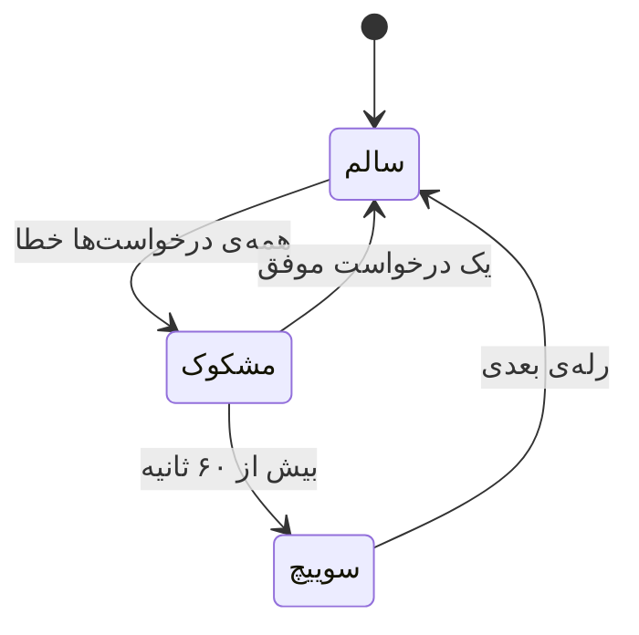

# کاربران، سهمیه و دوستان

[← بازگشت به README](../README.md)


پروکسی به‌صورت پیش‌فرض **تک‌کاربره و بدون رمز** است — دقیقاً مثل حالت شخصی.
برای اشتراک با دیگران، صفحه‌ی **کاربران** → سوییچ احراز هویت را روشن کنید.

| قابلیت | جزئیات |
|:--|:--|
| 🔑 احراز هویت HTTP | `Proxy-Authorization: Basic` — RFC 7235 |
| 🔑 احراز هویت SOCKS5 | نام‌کاربری/رمز — RFC 1929 |
| 📊 شمارش حجم | جداگانه برای هر کاربر، آپلود و دانلود |
| ✂️ قطع خودکار | اتصال **زنده** در سقف سهمیه قطع می‌شود، نه فقط اتصال بعدی |
| 📅 تاریخ انقضا | برای هر کاربر جداگانه |
| 🔐 ذخیره‌ی رمز | PBKDF2-HMAC-SHA256 با ۱۲۰٬۰۰۰ دور — هرگز متن ساده |
| ⚡ اعمال فوری | تغییرات بدون ری‌استارت روی رله‌ی در حال اجرا اعمال می‌شوند |

### اشتراک در شبکه‌ی محلی

```jsonc
// در صفحه‌ی «ساخت کانفیگ» یا مستقیم در config.json
"lan_sharing": true     // پروکسی روی 0.0.0.0 گوش می‌دهد
```

> ⚠️ **همیشه با هم:** اگر `lan_sharing` را روشن می‌کنید حتماً احراز هویت را هم
> روشن کنید، وگرنه هر دستگاهی در شبکه بدون رمز از پروکسی شما استفاده می‌کند.
> پنل این هشدار را خودش نشان می‌دهد.

### ساختار ذخیره‌سازی

```jsonc
"proxy_auth": {
  "enabled": true,
  "realm": "Aras-GP",
  "users": [
    {
      "username": "ali",
      "salt": "…", "hash": "…", "iterations": 120000,
      "quota_bytes": 5368709120,        // ۵ گیگابایت — ۰ یعنی نامحدود
      "expires_at": "2027-03-01",       // خالی یعنی بدون انقضا
      "enabled": true,
      "up_bytes": 0, "down_bytes": 0,
      "note": "موبایل"
    }
  ]
}
```

---

<a id="failover"></a>

## 🔀 سوییچ خودکار بین رله‌ها

هر زنجیره‌ی کارکرده را می‌توانید در صفحه‌ی دیپلوی با یک نام **ذخیره** کنید.
دفعه‌ی بعد به‌جای دیپلوی دوباره، یک کلیک سوییچ می‌کنید.

با روشن‌کردن **«سوییچ خودکار»** در تنظیمات، اگر رله‌ی فعال بیش از آستانه
(پیش‌فرض ۶۰ ثانیه) پیوسته خطا بدهد، پنل خودش به رله‌ی بعدی می‌رود.



**تشخیص کاملاً منفعل است.** از روی شمارنده‌های ترافیک واقعی خوانده می‌شود، نه
پینگ دوره‌ای — چون یک ابزار عبور از سانسور که هر چند ثانیه heartbeat می‌فرستد،
هم سهمیه‌ی Apps Script را هدر می‌دهد و هم یک الگوی قابل‌شناسایی روی شبکه می‌سازد.

محافظت در برابر نوسان:

- رله‌ی **بی‌کار** هرگز «خراب» حساب نمی‌شود — بدون ترافیک، بدون قضاوت
- اگر **اخیراً موفقیتی** بوده، سوییچ نمی‌کند (یعنی یک سایت خراب کل تونل را جابه‌جا نمی‌کند)
- حداقل فاصله بین دو سوییچ: ۹۰ ثانیه
- با کمتر از دو رله‌ی ذخیره‌شده، اصلاً کاری نمی‌کند

---

<a id="backup"></a>
